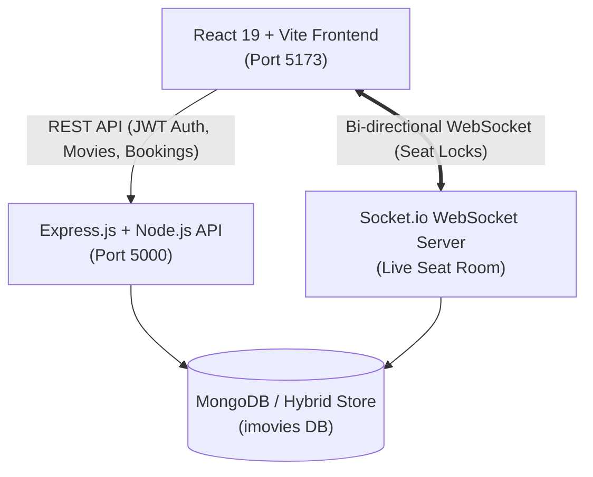

# 🎬 IMovies — Next-Gen Full-Stack Cinema Ticket Booking Platform

**IMovies** is a full-stack cinema and multiplex ticketing management platform built with the **MERN Stack** (MongoDB, Express.js, React.js, Node.js) and **Socket.io**. It provides real-time seat availability tracking, tiered seating maps (VIP Recliners, Premium Club, Standard Classic), secure JWT role-based authentication, digital perforated cinema passes with scannable QR verification, simulated multi-gateway checkout, and an Administrative Command Center.

---

## 🌟 Key Features

1. **Real-Time Seat Locking & Availability Engine (Socket.io)**
   - Concurrent customers see seat selections and locks update dynamically in real time without refreshing.
   - 5-minute seat reservation hold countdown timer to avoid booking conflicts.
   - Automated seat release on client disconnect or hold expiration.
2. **Interactive Cinematic Seating Map**
   - Curved projection screen curve with dynamic projector light beam.
   - Tiered seating structure:
     - 👑 **VIP Recliners** (Rows A-B): Luxury recliners with in-seat dining service.
     - ✨ **Premium Club** (Rows C-D): Center-stage prime viewing angle.
     - 💺 **Standard Classic** (Rows E-F): High-definition spatial sound tier.
   - Distinct statuses: *Available*, *Selected* (neon emerald glow), *Reserved/Locked* (pulsing amber), and *Sold Out* (dark slate).
3. **Comprehensive Search & Multi-Filter Engine**
   - Search by title, director, or cast members.
   - Filter pills for Genre (*Sci-Fi, Action, Adventure, Drama, Cyberpunk, Biography, Animation*).
   - Filter by Language (*English, Spanish, Japanese, German*) and Status (*Now Showing, Coming Soon*).
4. **Digital Perforated Cinema Pass with Scannable QR Code**
   - Perforated cinema admission pass with circular edge cutouts.
   - Cryptographically verifiable QR code containing booking reference, seats, customer name, and theatre screen details.
   - Built-in ticket print/save functionality (`window.print()`).
5. **Customer Booking & Instant Cancellation**
   - User ticket wallet displaying active admission passes and past booking history.
   - Instant ticket cancellation with automated 85% refund calculation and seat release back to the live cinema pool.
6. **Simulated Multi-Gateway Checkout & Promo Codes**
   - Credit/Debit Cards, Instant UPI (Google Pay, PhonePe), and Net Banking (Chase, BofA, Wells Fargo).
   - Promotional discount coupons: `IMOVIES50` ($50 off) and `VIPPASS` (20% off).
   - Celebratory particle confetti on successful reservations (`canvas-confetti`).
7. **Role-Based Security & Middleware**
   - JSON Web Token (JWT) stateless authentication.
   - Password encryption using `bcryptjs` (salt rounds: 10).
   - Protected API routes and role authorization (`user` vs `admin`).
   - Express rate limiting (`express-rate-limit`) to prevent brute-force attacks and abuse.
8. **Admin Command Center**
   - Real-time revenue metrics, tickets sold counter, and box office ledger.
   - Full CRUD management for movie library (poster, backdrop, runtime, genres, rating, status).
   - Showtime scheduler with automatic 60-seat matrix generation for multiplex screens.

---

## 🏛️ System Architecture



---

## 📋 Database Design (Collections)

| Collection | Description | Key Fields |
|---|---|---|
| **Users** | Customer & Admin accounts | `name`, `email`, `password` (hashed), `role` (`user`/`admin`), `phone`, `avatar` |
| **Movies** | Cinema film listings | `title`, `description`, `poster`, `backdrop`, `trailerUrl`, `genre[]`, `language[]`, `duration`, `rating`, `certification`, `status` |
| **Theatres** | Multiplexes & locations | `name`, `location`, `city`, `address`, `screensCount`, `facilities[]`, `rating` |
| **Shows** | Movie showtime schedules | `movie`, `theatre`, `screenName`, `showDate`, `showTime`, `format`, `pricing {vip, premium, standard}`, `availableSeats` |
| **Seats** | Individual auditorium seats | `show`, `seatNumber`, `row`, `col`, `tier`, `price`, `status` (`available`/`locked`/`booked`), `lockedBy`, `lockedAt` |
| **Bookings** | Ticket reservation records | `bookingNumber`, `user`, `show`, `movie`, `theatre`, `seats[]`, `subtotal`, `convenienceFee`, `discount`, `totalAmount`, `paymentStatus`, `bookingStatus`, `qrCode` |
| **Payments** | Financial transactions | `booking`, `user`, `transactionId`, `paymentMethod`, `amount`, `status`, `paidAt` |
| **Notifications**| Real-time alerts | `user`, `title`, `message`, `type`, `isRead`, `createdAt` |

---

## 🔑 Demo Credentials

| Role | Email | Password | Access Level |
|---|---|---|---|
| **Administrator** | `admin@imovies.com` | `adminpassword123` | Full Admin Panel, Revenue Analytics, CRUD Movies & Shows |
| **Customer** | `alex@example.com` | `userpassword123` | Movie Browsing, Seat Booking, QR Pass Wallet, Cancellation |

*(Note: The login page includes quick **One-Click Demo Login** buttons for instant access).*

---

## 🚀 Getting Started

### Prerequisites
- **Node.js**: v16.0.0 or higher (v22 tested)
- **npm**: v8.0.0 or higher
- **MongoDB**: Local MongoDB community service or MongoDB Atlas connection string (app includes a hybrid zero-config persistence fallback if MongoDB is not running).

### 1. Installation

```bash
# Clone or navigate into the project directory
cd imovies-cinema

# Install server dependencies
cd server
npm install

# Install client dependencies
cd ../client
npm install
```

### 2. Environment Configuration

Check `server/.env`:
```env
PORT=5000
MONGODB_URI=mongodb://127.0.0.1:27017/imovies
JWT_SECRET=imovies_super_secret_jwt_key_2026_cinema
CLIENT_URL=http://localhost:5173
NODE_ENV=development
```

### 3. Running the Application

In **Terminal 1** (Backend Server):
```bash
cd server
npm start
# Server starts on http://localhost:5000 with live Socket.io engine
```

In **Terminal 2** (Frontend Client):
```bash
cd client
npm run dev
# Frontend launches on http://localhost:5173
```

Open your browser at **`http://localhost:5173`**.

---

## 📡 REST API Reference

### Authentication
- `POST /api/auth/register` — Create new customer account
- `POST /api/auth/login` — Login with email/password and obtain JWT token
- `GET /api/auth/me` — Get authenticated user profile *(Bearer Token required)*

### Movies
- `GET /api/movies` — List movies (Supports query params: `search`, `genre`, `language`, `status`)
- `GET /api/movies/:id` — Get movie details and upcoming scheduled shows
- `POST /api/movies` — Add new movie *(Admin only)*
- `PUT /api/movies/:id` — Update movie *(Admin only)*
- `DELETE /api/movies/:id` — Delete movie *(Admin only)*

### Theatres & Shows
- `GET /api/theatres` — List cinemas & multiplex facilities
- `GET /api/shows` — Get scheduled shows by `movieId`, `theatreId`, or `date`
- `GET /api/shows/:id` — Get show auditorium layout, pricing, and 60-seat matrix
- `POST /api/shows` — Schedule new show and auto-generate seats *(Admin only)*
- `DELETE /api/shows/:id` — Remove scheduled show *(Admin only)*

### Bookings & Payments
- `POST /api/bookings` — Reserve seats, generate verified QR code pass, process payment
- `GET /api/bookings/my` — Get user's active & past cinema passes *(Customer only)*
- `GET /api/bookings/:id` — Get single booking with digital ticket details
- `POST /api/bookings/:id/cancel` — Cancel booking, release seats, and trigger refund

### Administrator Analytics
- `GET /api/admin/stats` — Overall revenue, ticket metrics, and transactions ledger *(Admin only)*

---

## 🎨 Visual Design Aesthetics
- **Dark Mode Palette**: Deep obsidian backdrop (`#07090e`), neon ultraviolet accents (`#8b5cf6`), electric cyan (`#06b6d4`), and gold (`#f59e0b`).
- **Typography**: `Outfit` for display headings and `Inter` for interface elements.
- **Micro-Animations**: Hover cards with perspective lift, smooth screen curvature, and live seat hold pulsing.
